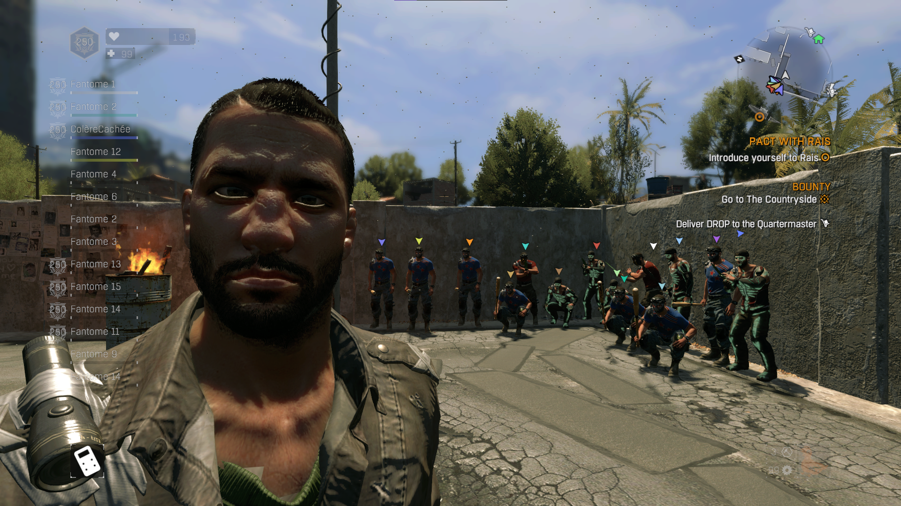

# DLCoop — coop massive pour Dying Light 1.55

> ⚠️ **Branche historique `dll-injection`.** C'est l'ancienne version : le lanceur (1.2.0) démarre le jeu en
> pause et y **injecte** les DLL du mod. Ce motif est signalé par certains antivirus. La version actuelle et
> recommandée, sans injection (chargeur `winmm.dll`), est sur la branche **`main`**.
> Différences : [docs/chargement-des-mods.md](docs/chargement-des-mods.md).




**DLCoop** permet de jouer à **Dying Light 1.55** (Steam) en coopération **jusqu'à 32 joueurs** (+ 1 joueur zombie
en mode « Be the Zombie »), au lieu de 4. Il comprend :

- un **mod** (`coop6.dll`) qui lève les limites du jeu (lobby, liste des joueurs, HUD, couleurs, difficulté,
  apparitions de zombies, rassemblement de mission, Be the Zombie à N chasseurs…) ;
- un **lanceur** Windows (`DLCoop.exe`) qui règle le mod, lance le jeu et y injecte les DLL ;
- un **serveur relais** à installer sur un petit VPS, pour jouer **par Internet sans VPN** ni port à ouvrir ;
- un outil de **plusieurs instances du jeu sur un même PC** (tests, ou plusieurs joueurs sur une machine).

> **EN** — DLCoop is a co-op mod for Dying Light 1.55 (Steam, Windows) raising the player limit from 4 to 32
> (+1 Night Hunter). It ships a mod DLL, a launcher (install / settings / launch), a UDP relay server to play over the
> Internet without a VPN, and a multi-instance tool. The launcher UI is in English; documentation and code comments
> are in French. Download the latest build from the **Releases** page.

Mod personnel, **non affilié à Techland**. Aucun fichier du jeu n'est fourni ni modifié sur le disque : le mod agit
en mémoire, après avoir vérifié les octets de la version 1.55.

## Jouer (joueurs)

1. **Prérequis** : Dying Light **1.55** sur Steam, Windows 10 (1803+) ou 11 en 64 bits. Rien d'autre à installer
   (le lanceur utilise le .NET Framework intégré à Windows). Si **DLML** est installé (`dsound.dll` dans le dossier du
   jeu), le désactiver pour la coop (renommer `dsound.dll`).
2. Télécharger `DLCoop_<version>.zip` dans les **Releases**, le décompresser n'importe où.
3. Lancer `DLCoop.exe` : le jeu est trouvé automatiquement. **Install mod**, puis renseigner **Server IP** (le
   relais de votre groupe) et le **mot de passe de session** (le même pour tous), puis **Launch**.
   Laisser *Server IP* vide pour jouer en réseau local ou par un VPN de type LAN (Radmin VPN…).
4. L'hôte crée une partie coop ; les autres la rejoignent avec **Quick match**. **Tous** les joueurs, hôte compris,
   doivent avoir le mod.

Plusieurs fenêtres de jeu sur un même PC : *Instance > Additional instance*, puis **Launch** (une identité Steam et une
adresse par fenêtre). **Uninstall mod** remet le dossier du jeu dans son état d'origine.

> **Jamais en partie publique** : Dying Light est protégé par VAC. DLCoop sert aux parties **LAN** (y compris par
> le relais, que le jeu voit comme un réseau local) ; Steam en mode hors ligne est conseillé.

## Contenu du dépôt

| Dossier | Contenu | Documentation |
|---|---|---|
| `mods/coop6/` | le mod coop (`coop6.dll`) : liste de toutes les modifications, avec leurs adresses dans la 1.55 | [`mods/coop6/README.md`](mods/coop6/README.md) |
| `src/` | structures du jeu utilisées par le mod (en-têtes, dispositions vérifiées sur le code machine) | — |
| `tools/dlcoop/` | le lanceur `DLCoop.exe` (WPF, .NET Framework 4.7.2) et la construction du paquet | [`docs/lanceur.md`](docs/lanceur.md) |
| `tools/relais/` | le serveur relais (C++17, Linux), service systemd, pare-feu, conteneur | [`docs/serveur-relais.md`](docs/serveur-relais.md) |
| `tools/fantome/` | `dlcoop_reseau.dll` (réseau, identités, instances), `fantome.exe` et `pont.exe` (outils de test) | [`docs/plusieurs-instances.md`](docs/plusieurs-instances.md) |
| `tests/` | tests sans le jeu : course du chargeur, protocole du relais, installation du mod | — |
| `docs/` | fonctionnement détaillé, compilation, méthodes de chargement | ci-dessous |

## Documentation

- [Fonctionnement du lanceur](docs/lanceur.md) : installation, réglages, lancement, relais, plusieurs instances.
- [Charger des mods dans le jeu](docs/chargement-des-mods.md) : injection de DLL, chargeur `winmm.dll` (façon
  DLML), DLML lui-même ; pourquoi DLCoop est passé de l'un à l'autre (antivirus).
- [Compilation](docs/compilation.md) : construire le mod, le chargeur, le lanceur et le serveur ; comment le jeu
  lui-même a été compilé (et pourquoi c'est important pour le mod).
- [Le mod coop](docs/mod-coop.md) : les limites du jeu et la façon dont elles sont levées.
- [Le serveur relais](docs/serveur-relais.md) : principe, installation sur un VPS, protocole.
- [Plusieurs instances sur un PC](docs/plusieurs-instances.md) : identité Steam, adresses, verrou du jeu.

## Compiler

Prérequis : Visual Studio Build Tools 2022 avec l'ensemble d'outils **MSVC v141 (14.16)**, le SDK .NET (pour
compiler le lanceur), Python 3 avec `pefile`. Puis, dans PowerShell à la racine du dépôt :

```powershell
.\tools\dlcoop\build.ps1                          # -> out\dlcoop\paquet\ et out\dlcoop\DLCoop_<version>.zip
.\tools\dlcoop\build.ps1 -Relais 203.0.113.10     # idem, adresse du relais préremplie pour un groupe
```

Détails, compilation reproductible et serveur : [`docs/compilation.md`](docs/compilation.md).

## Branches

| Branche | Contenu |
|---|---|
| `main` | version actuelle : chargeur `winmm.dll`, lanceur 1.3.x (aucune injection de DLL) |
| `dll-injection` | ancienne version (lanceur 1.2.0) : le lanceur crée le jeu en pause et y injecte les DLL du mod. Conservée pour référence ; signalée par certains antivirus. |
